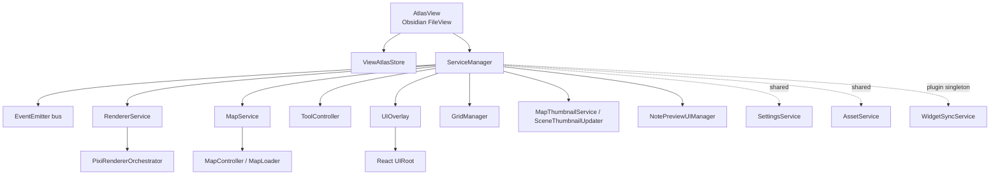
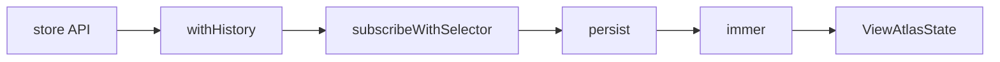
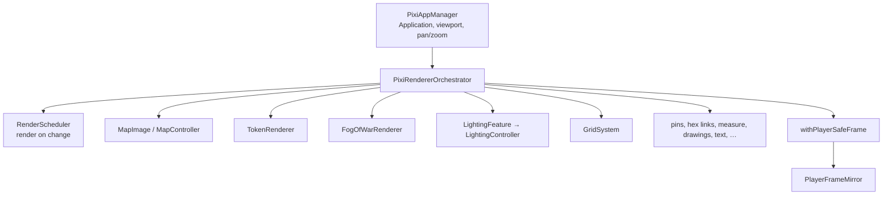

# C4 Level 3 — Components

Focused component views for the three places most extenders touch: the map view
runtime, the Zustand store, and the PIXI render stack.

Deep rules: [`CLAUDE.md`](../../CLAUDE.md) (Undo/Redo History, Rendering and
teardown, Player window, Dynamic lighting, Vault files).

## 1. Map view runtime

| Component | Path | Responsibility |
| --- | --- | --- |
| `AtlasView` | `src/app/atlas-view.ts` | Obsidian leaf orchestrator: create store and ServiceManager, load/save scene, own lifecycle. |
| `ServiceManager` | `src/app/services/ServiceManager.ts` | Per-view registry; constructs services with the view store and bus. |
| `EventEmitter` | Node `events` via ServiceManager | Inter-service events (`renderer-ready`, `map-unloading`, `dice-rolled`, …). |
| `RendererService` | `src/app/services/RendererService.ts` | Owns one `PixiRendererOrchestrator` for the leaf. |
| `MapService` | `src/app/services/MapService.ts` | Scene load into the store; coordinates with the renderer. |
| `ToolController` | `src/app/services/ToolController.ts` | Active tool ↔ store and PIXI input. |
| `UIOverlay` | `src/app/services/UIOverlay.ts` | DOM layers + `mountUI` → React. |

**Extension tip:** new per-view behaviour usually adds a service constructed in
`ServiceManager`, or a tool wired through `ToolController` / the orchestrator’s
pointer dispatch. Prefer the store as the integration boundary with React.

## 2. State (ViewAtlasStore)

Middleware stack (outer → inner), from [`storeFactory.ts`](../../src/app/storeFactory.ts):

| Layer | Role |
| --- | --- |
| `withHistory` | Undo/redo on tracked slices; `store.temporal`. See `src/app/stores/history/`. |
| `subscribeWithSelector` | Efficient subscriptions for renderers and React. |
| `persist` | Scene file persistence through Atlas storage / `MapPersistence`. |
| `immer` | Mutable-looking recipes; reference equality for unchanged entities. |

**Tracked for undo** (only): `objects`, `grid`, `background`, `widgetValues`,
`exploredEdits`. Selection, camera, tools, loading flags, and UI popovers are
not undo steps.

**UI slice** (`src/app/stores/uiSlice.ts`): panels, tools, light/zone popovers —
not saved, not undo-tracked.

**History API** (`src/app/stores/history.ts`):

- One gesture → `beginHistoryTransaction` / `endHistoryTransaction` (or `runHistoryTransaction`).
- Atlas-internal writes that must not undo → `runUntracked`.
- Cancelled gesture → `abandonHistoryTransaction`.

## 3. Render stack

| Component | Path | Responsibility |
| --- | --- | --- |
| `PixiAppManager` | `src/app/pixi/PixiAppManager.ts` | PIXI Application, viewport plugins (right-drag pan), resize. |
| `PixiRendererOrchestrator` | `src/app/PixiRendererOrchestrator.ts` | Owns domain renderers, layer order, player-safe capture. |
| `RenderScheduler` | `src/app/pixi/RenderScheduler.ts` | Renders only when PIXI has pending changes; before-render hooks for the player mirror. |
| `MapController` / `MapImage` | `src/app/MapController.ts`, `src/app/pixi/mapImage/` | Tiled map background, stretch, demand regions. |
| `TokenRenderer` | `src/app/pixi/token-renderer/` | Tokens, interaction dispatch, player sight presentation. |
| `FogOfWarRenderer` | `src/app/pixi/fog/` | Fog paint/erase and coverage. |
| `LightingFeature` | `src/app/pixi/lighting/LightingFeature.ts` | Builds `LightingController` only while experimental dynamic lighting is on. |
| Layer Z | `src/app/pixi/mapLayerOrder.ts` | Stacking for marks and tools above the lighting composite. |

**Player frame:** geometry in `services/playerFrame.ts` (pure); capture via
`withPlayerSafeFrame`; copy to the player canvas through `PlayerFrameTexture` /
`PlayerFrameMirror`. GM overlays stay in `GmOverlays`; do not invent a second
player-visibility list.

**Teardown:** destroy display objects with `destroyTree`
(`src/app/pixi/utils/destroyTree.ts`), not `removeChild` alone.

## Related diagrams

- Sequences: [uml-sequences.md](uml-sequences.md)
- Packages / classes: [uml-classes.md](uml-classes.md)
- Domains: [domains.md](domains.md)
