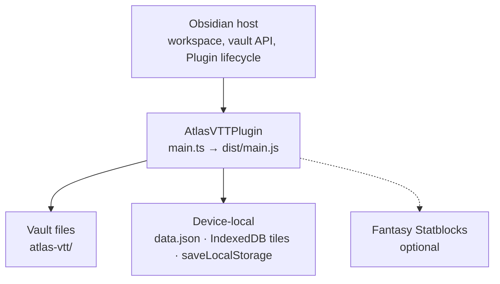
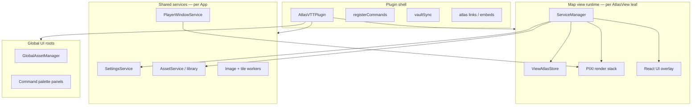

# C4 Level 2 — Containers

Atlas is one Obsidian plugin bundle. Inside it, work splits into a plugin shell,
per-map view runtimes, shared services, and a few global UI roots.

## External and device stores

| Store | What lives there |
| --- | --- |
| **Vault `atlas-vtt/`** | Scenes, maps, tokens, encounters, collection folders, library JSON, user presets. Syncs with the vault. |
| **Plugin `data.json`** | GM preferences via `SettingsService` (hotkeys, toolbar layout, experimental flags, dice look, …). |
| **Device-local** | Map tile pyramids (IndexedDB), presented scene, crash markers, input mode, `.atlas-data/` index cache. See [data-places.md](data-places.md). |

## Containers inside the plugin

### Plugin shell

[`main.ts`](../../main.ts) owns lifecycle: error log, storage migration, settings,
vault sync registration, view types, commands, changelog, dice look sync, and
unload cleanup. Views are registered early so workspace restore can reopen Atlas
tabs before slower startup work finishes.

### Map view runtime

Each [`AtlasView`](../../src/app/atlas-view.ts) leaf gets:

- One [`createViewAtlasStore`](../../src/app/storeFactory.ts) (Zustand + Immer + persist + history).
- One [`ServiceManager`](../../src/app/services/ServiceManager.ts) wiring renderer, map load, tools, grid, UI, thumbnails, and a per-view `EventEmitter` bus.
- PIXI owned by [`RendererService`](../../src/app/services/RendererService.ts) → [`PixiRendererOrchestrator`](../../src/app/PixiRendererOrchestrator.ts).
- React chrome via [`UIOverlay`](../../src/app/services/UIOverlay.ts) → [`UIRoot`](../../src/app/react/UIRoot.tsx).

Other Obsidian view types: `DashboardView`, `LocalPlayerView`, loot query view.

### Shared services

| Container | Entry | Notes |
| --- | --- | --- |
| Settings | `SettingsService` | One instance on the plugin; `forApp` must stay unique. |
| Library | `AssetService` + `services/library/` + `vault-sync/` | Vault files win over the device index. |
| Player window | `PlayerWindowService` | Extra render of player-safe layers into the popout canvas. |
| Widgets | `WidgetSyncService` | Lazy singleton on the plugin; mirrors collection widgets across views. |
| Workers | `ImageWorkerPool`, `TileDecoderClient` / `MapImageService` | Released in `onunload`. |

### Global UI roots

Separate React roots (not inside a map leaf): full-screen asset manager, image
display, some modals and settings tabs. They still talk to `AssetService` and
`SettingsService`.

## Next level

See [c4-components.md](c4-components.md) for component breakdowns of the map
view, store, and render stack.
