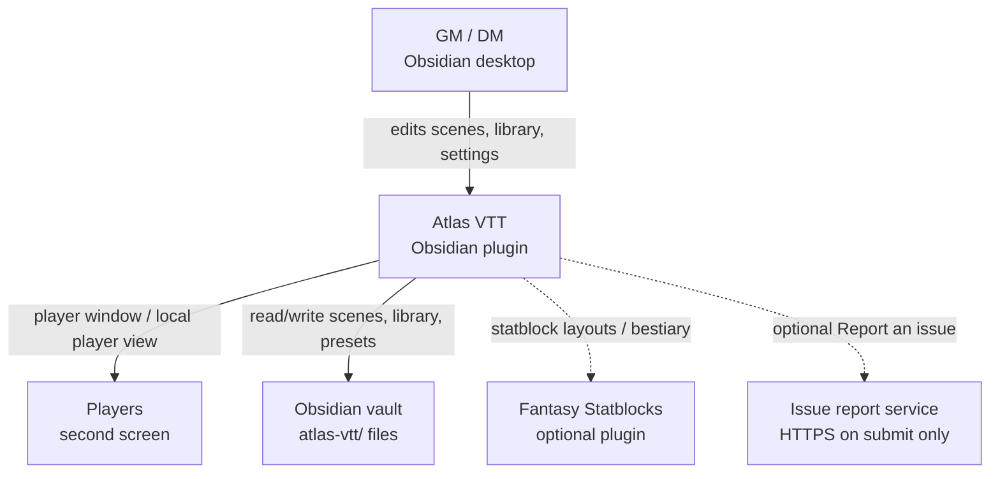

# C4 Level 1 — System context

Atlas VTT is a single Obsidian community plugin. It runs offline by default:
maps, tokens, notes, audio and settings stay in the vault. Network use is
optional and disclosed in [`PRIVACY.md`](../../PRIVACY.md).

## Context diagram

## People and systems

| Element | Role |
| --- | --- |
| **GM / DM** | Primary user. Opens maps in Obsidian workspace leaves, edits the library, presents a scene to players. |
| **Players** | View a separate player window (or local player view). They do not edit the vault through Atlas. |
| **Atlas VTT** | Bundled plugin (`main.js`, `manifest.json`, `styles.css`). Owns PIXI map rendering, React UI, vault library sync, and the player presentation. |
| **Obsidian vault** | Authoritative store for scenes (`.atlasmap`), tokens, encounters, collection settings, and user system presets under `atlas-vtt/`. |
| **Fantasy Statblocks** | Optional companion plugin. Atlas uses its layouts and bestiary when present; without it, no layout callbacks run. |
| **Issue report service** | Contacted only when the user submits a report. No telemetry, accounts, ads, or self-update. |

## Privacy notes for extenders

- Do not add network endpoints without updating [`README.md`](../../README.md) and [`PRIVACY.md`](../../PRIVACY.md) ([CONTRIBUTING](../../CONTRIBUTING.md)).
- External image URLs are the other intentional network path (token/map art the GM supplies).
- Image and map-tile workers run bundled code from local blob URLs; they never download code.

## Next level

See [c4-containers.md](c4-containers.md) for containers inside the plugin.
