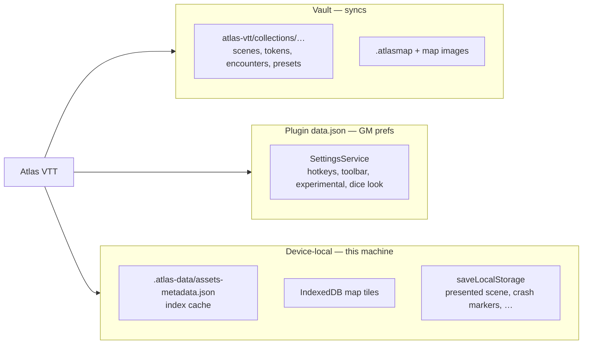

# Where Atlas data lives

Atlas separates **three kinds of data into three places**. Choosing the wrong
place breaks vault sync or leaks device facts into shared files. Full rules:
[`CLAUDE.md`](../../CLAUDE.md) “Vault files and the asset index”, and
[`PRIVACY.md`](../../PRIVACY.md).

## Overview

| Kind | Place | Syncs across devices? |
| --- | --- | --- |
| Content and library facts | Vault files under `atlas-vtt/` | Yes (with the vault) |
| GM preferences | Plugin `data.json` via `SettingsService` | Via Obsidian plugin data sync if enabled; not library content |
| Device facts | `app.saveLocalStorage`, IndexedDB, `.atlas-data/` cache | No |

## 1. Vault library files

Authoritative records for maps, scenes, tokens, notes, encounters, characters,
statblock-linked assets, collection settings, and user system presets.

| Pattern | Role |
| --- | --- |
| `atlas-vtt/collections/<id>/` | Collection folder; **folder name is the collection id** |
| Record JSON (`tokens/<id>.json`, scene/map records, …) | Full asset record; payload + `atlasRecord` metadata |
| `collection.json` | Collection settings (without id/name — those are the folder) |
| `library.json` | `defaultCollectionId`, `vaultId`, `starterTokensAdded` |
| `system-presets/` | User game-system preset files |
| Scene `.atlasmap` + images | Map scene state and art |

**Rules for extenders:**

- Never store library-only facts in the device index. The index is a cache.
- Writes go through `LibraryWriter` after content changes; vault file content
  wins on reconcile (`readLibraryChanges` / `mergeLibraryChanges`).
- Moves/copies use `transferAssets` — do not change `collection` via a bare
  `updateAsset`.
- Sync tools may skip dot-folders and `_`-prefixed names; keep library data in
  visible vault paths.

## 2. Plugin settings (`data.json`)

GM preferences: hotkeys, toolbar layout, experimental feature switches, dice
display/look, changelog prefs, lighting quality preference wiring, and similar.

- Read/write through [`SettingsService`](../../src/app/services/SettingsService.ts).
- One instance per app (held on `AtlasVTTPlugin`); `SettingsService.forApp` must
  not be replaced by a stale second instance.
- External edits are followed via `onExternalSettingsChange`.
- Hotkeys equal to this version’s defaults may be preserved as stored for older
  clients — see CLAUDE.md / SettingsService behaviour before “normalising” them away.

## 3. Device-local

| Mechanism | Examples |
| --- | --- |
| `app.saveLocalStorage` | Presented scene, lighting crash markers, input mode, migration flags, device id |
| IndexedDB (`atlas-vtt-map-tiles-…`) | Map tile pyramids keyed by image content hash |
| `.atlas-data/` | Asset index cache, import backups, unreadable-index copies |

Map tiles are rebuilt per device from vault images; they are never vault content.
Player presentation (which tab is “sent to players”) is a device fact.

## Scene files vs collection widgets

- Scene files hold scene-scoped widget copies and values.
- Collection-scoped widgets live in the collection library and are stripped from
  scene persistence (`withoutCollectionWidgets`).
- `WidgetSyncService` applies the library on load and mirrors across open views.

## Privacy alignment

- Offline by default; vault stays on the user’s machine.
- Optional HTTPS: external image URLs the GM sets, and issue reports the user
  submits ([PRIVACY.md](../../PRIVACY.md)).
- Do not document or implement silent telemetry, accounts, or vault upload.

## Checklist when adding persisted state

1. Is it part of the campaign library or a scene? → vault file (+ serializer / migrate).
2. Is it a GM preference for this install? → `AtlasSettings` / `SettingsService`.
3. Is it machine-specific (cache, presentation, crash bookkeeping)? → local storage / IndexedDB / `.atlas-data`.
4. Would putting it only in the index break another device’s sync? If yes, also write a vault file.
5. New network use? Update README + PRIVACY before merging.
