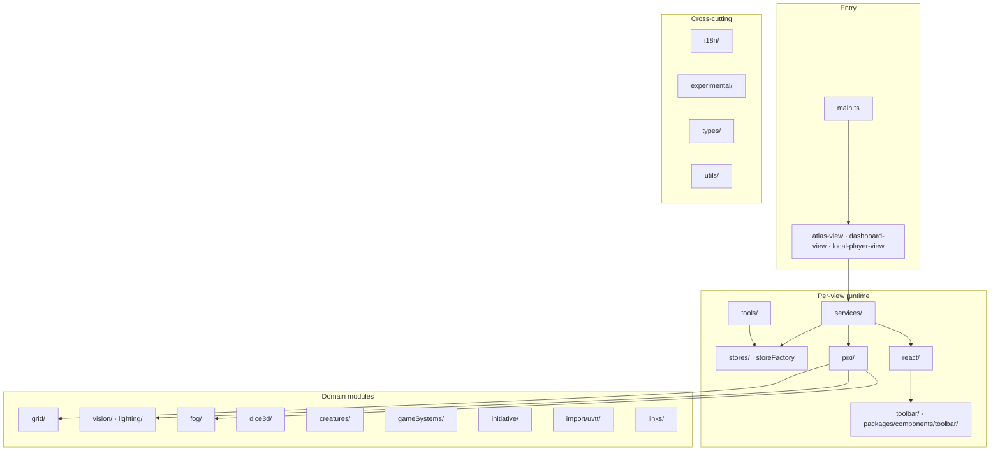
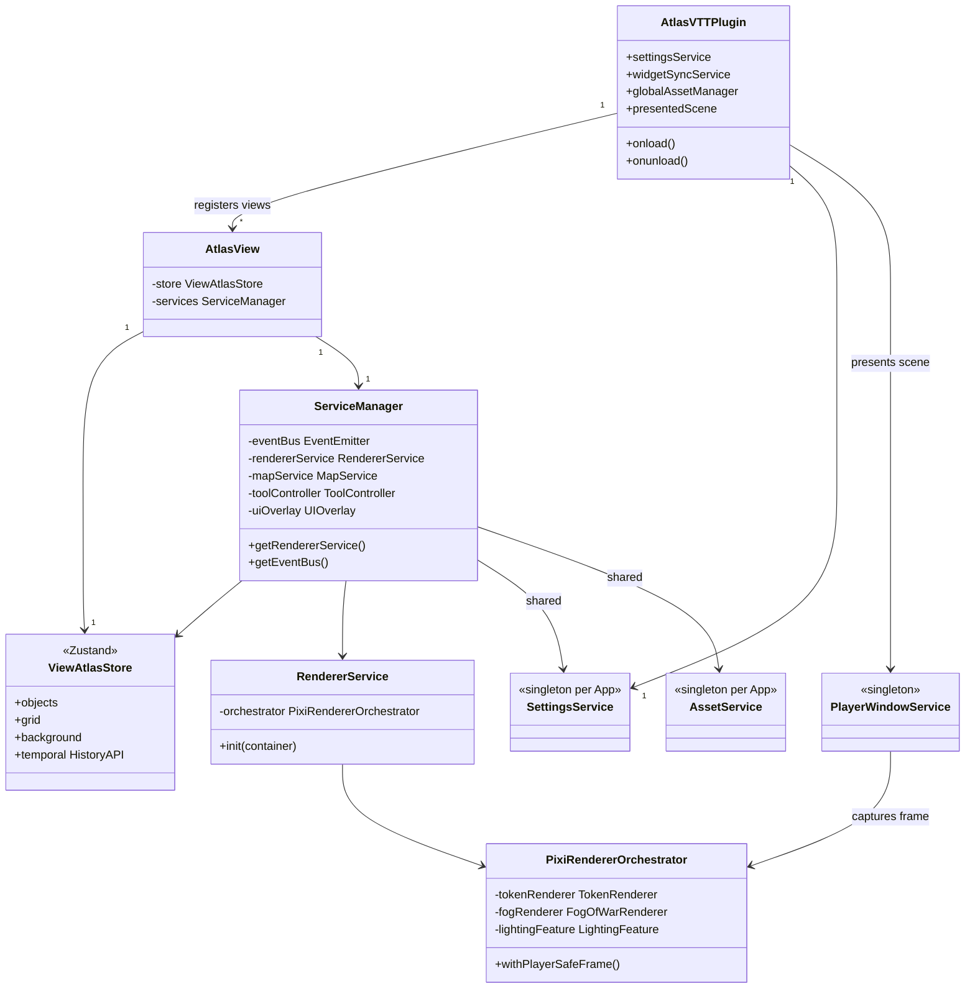
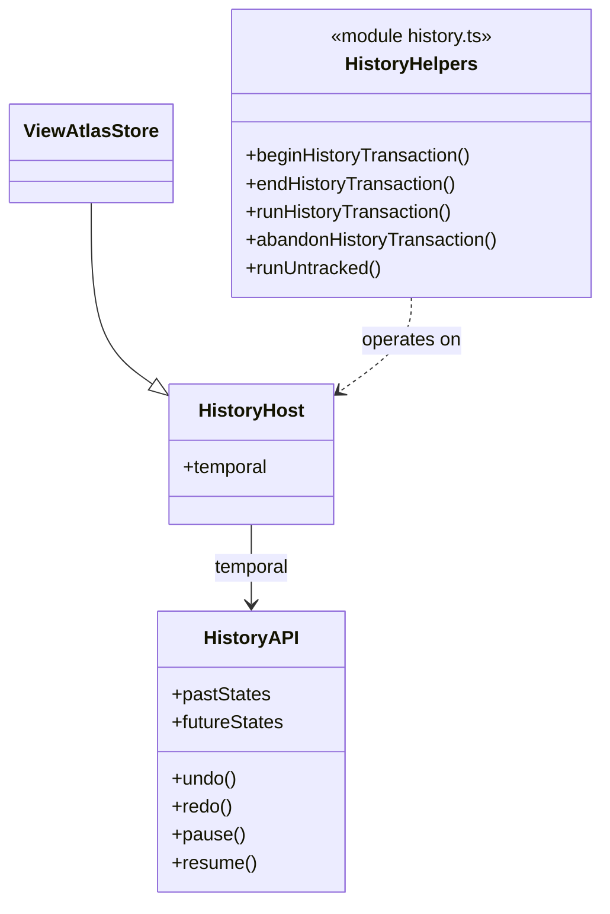

# UML — Packages and core classes

Focused views only. For exhaustive domain rules, use [`CLAUDE.md`](../../CLAUDE.md)
and the folders listed in [domains.md](domains.md).

## Package layout (`src/app/`)

| Package | Responsibility |
| --- | --- |
| `services/` | Plugin and per-view services (map, renderer, assets, player window, widgets, …). |
| `stores/` | Zustand slices, history middleware, UI slice. |
| `pixi/` | PIXI v8 rendering: map tiles, tokens, fog, lighting engine, helpers. |
| `react/` | Map chrome (`UIRoot`), command palette, initiative, dice display, settings panels. |
| `packages/components/` | Shared UI (toolbar, asset manager, primitives) — lives under the app tree, not a separate npm package. |
| `tools/` | Tool classes (measure, fog, dice, walls, …) driven by `ToolController`. |
| `grid/` | Lattice, numbering, hex geometry, stretch helpers. |
| `vision/` + `lighting/` | Pure sight/light rules; PIXI lighting lives under `pixi/lighting/`. |
| `gameSystems/` | Built-in presets, senses, light presets, dice/initiative rules readers. |
| `creatures/` | Statblock resolution, filters, `CreatureIndex`. |
| `i18n/` | `t()` + locale files; English is the source of keys. |

Repo root also holds `styles/` (SCSS → `styles.css`), `tests/` (unit + gpu), and
`docs/`.

## Core class relationships

### Boundaries to keep

| Boundary | Rule |
| --- | --- |
| Store ↔ PIXI / React | Renderers and UI subscribe to the store; avoid duplicating scene state in local component state for persisted facts. |
| ServiceManager ↔ shared services | Settings and AssetService are app-wide; do not construct a second `SettingsService` that would overwrite `forApp`. |
| History ↔ UI slice | Pointer/UI flags are not undo steps; tracked slices only. |
| Lighting rules ↔ GPU | Pure model in `vision/` / `lighting/`; engine in `pixi/lighting/engine/`. |
| Library ↔ index | Vault record files are authoritative; the index is a cache. |

### History surface

## Tests layout (for extenders)

| Project | Location | Use |
| --- | --- | --- |
| Unit | `tests/unit/`, colocated `__tests__` | Pure logic, jsdom, Obsidian mocks |
| GPU | `tests/gpu/`, `*.gpu.test.ts` | Browser + Chromium; lighting, layout, map seams |
| Oracles | `tests/oracles/` | Parity baselines (history, visibility, …) |

CI runs the unit project; GPU suites are local (`npm run test:gpu`).
