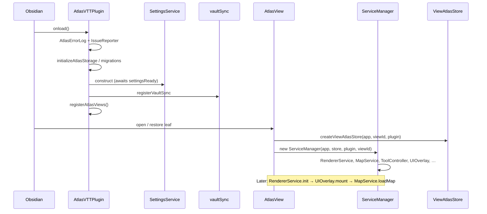
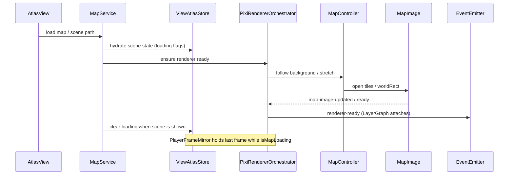
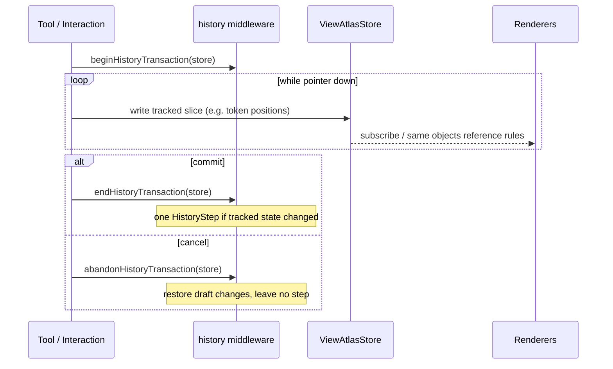
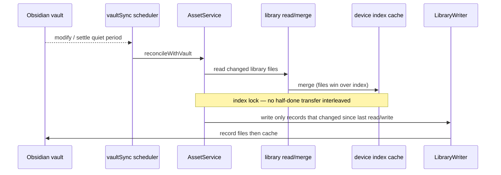

# UML — Critical sequences

Sequence diagrams for the flows most extenders need to keep intact. Details and
edge cases: [`CLAUDE.md`](../../CLAUDE.md).

## 1. Plugin load → map view open



Views register early so workspace restore can resolve Atlas tabs before slower
startup finishes (`main.ts`).

## 2. Scene load



Persistence round-trip uses `MapPersistence` / scene file writers. New saved
fields need migrate + store + serializer together.

## 3. Undoable gesture



Rules of thumb:

- Prefer one store action for bulk edits (`updateTokens`, `setTokenPositions`).
- Non-undoable Atlas maintenance → `runUntracked`.
- Explored-memory brush edits raise `exploredEdits` and use a parallel texel stack
  (`ExploredSteps`); see CLAUDE.md “Editing explored memory”.

## 4. Player frame mirror

```mermaid
sequenceDiagram
  participant Sched as RenderScheduler
  participant Mirror as PlayerFrameMirror
  participant Orch as PixiRendererOrchestrator
  participant Tex as PlayerFrameTexture
  participant Win as Player window canvas

  Sched->>Mirror: before-render hook (≤ PLAYER_MIRROR_FPS)
  Mirror->>Mirror: playerFrame(GM view, window size)
  alt frame valid and scene presentable
    Mirror->>Orch: withPlayerSafeFrame(copy, settings, frame)
    Orch->>Orch: player layers + frame camera
    Orch->>Tex: render stage to frame texture
    Tex->>Win: drawImage pieces from view canvas
    Orch->>Orch: restore GM camera / layers
  else loading / no frame / hidden window
    Note over Mirror,Win: keep last frame; mark stale as needed
  end
  Note over Sched: DM render in same task restores DM picture on the canvas
```

Geometry is pure (`services/playerFrame.ts`). Presentation state (freeze, zoom
lock, rotation when implemented) must not rewrite scene objects.

## 5. Vault reconcile (library sync)



Never put library facts only in the index. Moves/copies go through
`transferAssets` (`src/app/services/assetTransfer/`). See [data-places.md](data-places.md)
and CLAUDE.md “Vault files and the asset index”.
